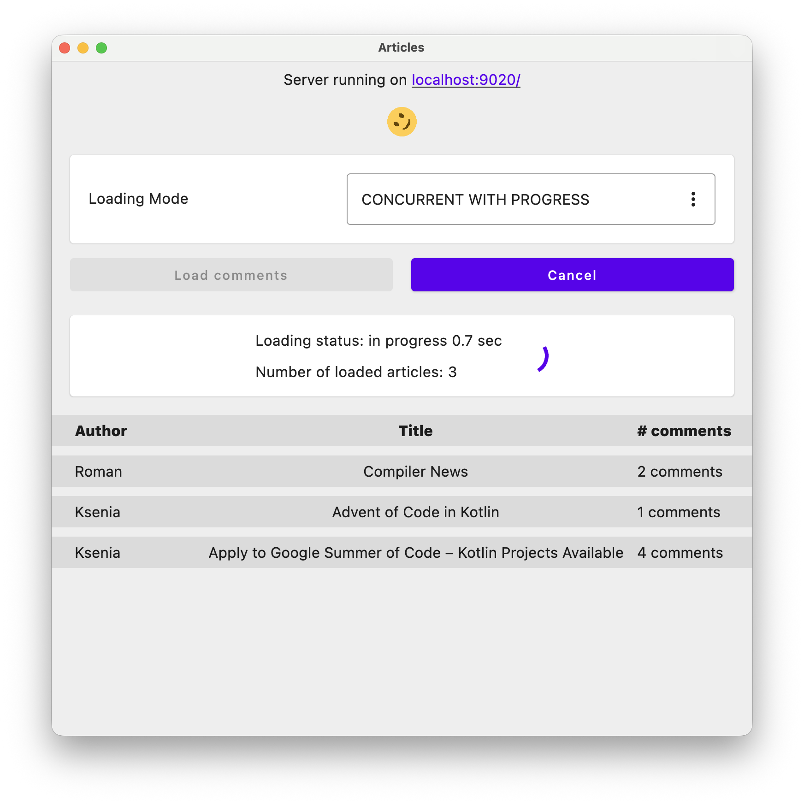

# Coroutines Tutorial: Articles App

A standalone, hands-on exercise for learning Kotlin coroutines by implementing loading strategies
for a small "Articles" feed.

## How to run

Run the `Articles` run configuration (or `desktop-client`'s `jvmRun` Gradle task) to launch the app.
On startup it automatically starts the backend server; once it's ready, the article browser appears
in the same window.

## Where to work

The hands-on exercises live in `desktop-client/src/jvmMain/kotlin/org/example/articles/tasks`. This
branch (`main`) contains the unsolved tasks; switch to the `solutions` branch to see one way of
implementing them. Each task also has a matching test in
`desktop-client/src/jvmTest/kotlin/org/example/articles/tasks`, using virtual time so you can check
your solution's behavior and timing without waiting for the simulated network delays.

